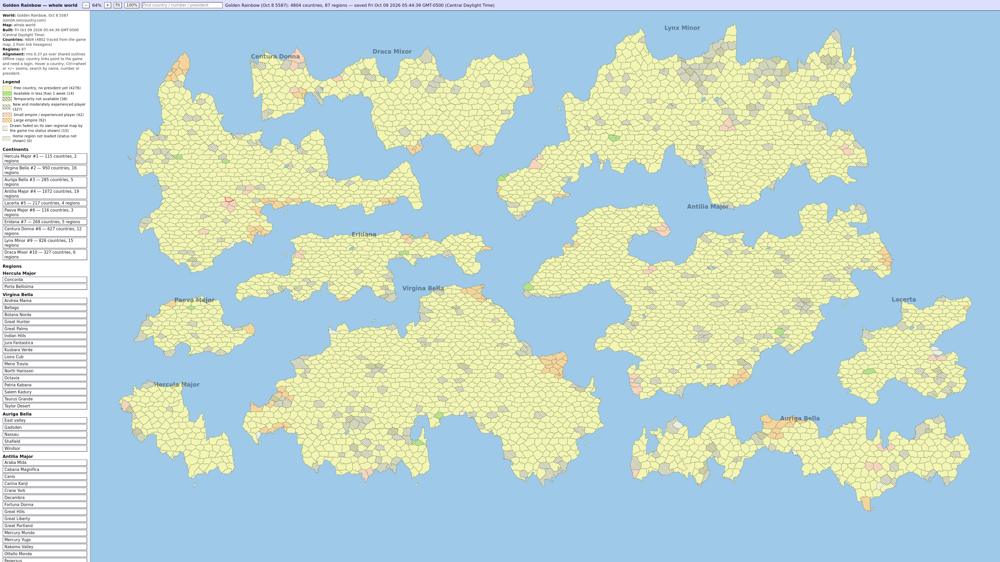

# Simcountry QoL Scripts

Browser userscripts that take the busywork out of [Simcountry](https://www.simcountry.com/) — the long-running browser MMO where you run countries, enterprises, trade, and wars across several persistent worlds.

This repo is a small toolkit for people who already play. It does not replace the game. It just makes a few of the most tedious pages easier to live with.

[](LICENSE)
[](https://www.tampermonkey.net/)
[](https://www.simcountry.com/)

| Script | Version | What it does |
| --- | --- | --- |
| [Galaxy Console.js](scripts/Galaxy%20Console.js) | 3.0.7 | CentauDos galaxy viewer and console: shuttle register, event log, flights, markets, docking, and gated writes |
| [Loan Offers.js](scripts/Loan%20Offers.js) | 1.5.0 | Sort, filter, highlight, total, and batch-submit loan offers |
| [Corporation Toolbox.js](scripts/Corporation%20Toolbox.js) | 2.4.1 | Unified sort/filter/select/apply for corporation lists and strategy forms |
| [Trading Toolbox.js](scripts/Trading%20Toolbox.js) | 1.2.5 | Sort, filter, select, and bulk-edit country and enterprise trading pages |
| [Profession Toolbox.js](scripts/Profession%20Toolbox.js) | 1.5.0 | Prefill profession changes and merge employment tabs |
| [Portal.js](scripts/Portal.js) | 1.3.0 | Reorder countries/enterprises and flick the news ticker |
| [Simcountry Cash Log — endless, sort, filter](scripts/Simcountry%20Cash%20Log%20%E2%80%94%20endless%2C%20sort%2C%20filter) | 1.6.0 | Sort, filter, cap, and export Cash Log plus sales and purchase logs |
| [War Casualty Bookmarklet](3rd%20Party/War%20Casualty%20Bookmarklet.txt) | 3rd party | Summarize war losses from a battle report page |

> Unofficial. Not affiliated with Simcountry or its operators. Use at your own risk, and stay inside the game's rules.

---

## Install

### Install Tampermonkey

1. Install [Tampermonkey](https://www.tampermonkey.net/) for your browser (Chrome, Firefox, Edge, Safari, etc.).
2. After install, the extension icon appears in the toolbar. Click it once to confirm it is active.

### Install a script

1. Open one of the raw URLs below (or click a script name in the table).
2. Tampermonkey should detect the userscript header and offer an **Install** button. Click it.
3. If the install prompt does not appear, open Tampermonkey → Dashboard → Utilities → Import from URL, paste the raw URL, and install. Or create a new script and paste the full file contents.
4. Visit the matching Simcountry page while logged in. The extra UI appears only on that page (or family of pages).

### Update a script

- Tampermonkey can check for updates if the script has an `@updateURL` (these do not). The simplest update is to reinstall from the current raw URL: open the raw link again and click Install (it will replace the existing copy).
- You can also open the installed script in the Tampermonkey editor, delete everything, paste the new file, and save.
- After an update, reload the Simcountry page. Preferences stored in Tampermonkey / `localStorage` usually survive.

Raw files:

- `https://github.com/WalkingGlitch/Simcountry/raw/main/scripts/Galaxy%20Console.js`
- `https://github.com/WalkingGlitch/Simcountry/raw/main/scripts/Loan%20Offers.js`
- `https://github.com/WalkingGlitch/Simcountry/raw/main/scripts/Corporation%20Toolbox.js`
- `https://github.com/WalkingGlitch/Simcountry/raw/main/scripts/Trading%20Toolbox.js`
- `https://github.com/WalkingGlitch/Simcountry/raw/main/scripts/Profession%20Toolbox.js`
- `https://github.com/WalkingGlitch/Simcountry/raw/main/scripts/Portal.js`
- `https://github.com/WalkingGlitch/Simcountry/raw/main/scripts/Simcountry%20Cash%20Log%20%E2%80%94%20endless%2C%20sort%2C%20filter`

Preferences are stored in Tampermonkey / `localStorage`. They stay on your machine.

---

## Galaxy Console

**File:** [`Galaxy Console.js`](scripts/Galaxy%20Console.js)  
**Userscript name:** Simcountry Galaxy Console  
**Author:** TheWalkingGlitch  
**Runs on:** the CentauDos galaxy root (`cgi2nova?SN_METHOD=gxRoot`) and related pages. Opens its own viewer window; a launcher button is injected on the main portal gadget.

Galaxy Console (formerly Galaxy+) is a full CentauDos viewer and console. It builds a local shuttle register and event log (IndexedDB, with CSV import/export), lists shuttles/stations/markets/docks, tracks flights, supports rename and bulk rename, and can submit transport requests. Writes are OFF by default and each write is confirmed against a captured live form. It also renders country/world map fragments as a normal page when opened with a map hash.


*Galaxy Console shuttle list and map on the CentauDos viewer.*

### Features

- Virtualized shuttle table with filters (name, owner, place, status, location), column modes, and bulk rename
- Shuttle register and event log stored in IndexedDB (CSV in/out); logbook lines accumulated per shuttle
- Stations, markets, docking lists, and shuttle flights with cadence-based refresh (active / idle / stale)
- Transport requests: staged queue, origins/targets/products pickers, form capture so the posted fields match the live form; writes gated (master switch + family switch + ownership, OFF by default)
- Rename (single and bulk) with the same gates
- Map viewer: same-origin map fragments rendered in-page with navigation stripped of scripts
- Launcher: button on the Worlds & Space Travel gadget (or a floating panel) that opens the console window
- Debug ring, request client with allowlists, session keepalive, and settings for every list length and cadence
- Notifications for arrivals (optional desktop + sound)

Nothing is written until you enable the relevant switches and confirm each action. The original game pages are only read (plus the added launcher button).

Full usage guide: [Galaxy Console.md](Galaxy%20Console.md).

---

## World maps

**Files:** [`World Maps/`](World%20Maps) — one self-contained HTML page per world, generator `Simcountry shaded world map 3.0.0`  
**Author:** TheWalkingGlitch  
**Runs on:** your browser, offline. These are saved snapshots, not a userscript, and they do not call the game when you open them.

Each file is a shaded whole-world map from the morning of 9 Oct 2026 (Central). Download the HTML and open it locally. The page draws the map, a zoom bar, and a side panel. Search matches country name, country number, or president. Continent and region buttons jump the view. Hover a country for the tip. Dashed boxes are regions placed approximately.


*Shaded world map viewer on a saved Simcountry world render.*

### Snapshots

- [Fearless Blue](World%20Maps/simcountry-fearless-blue-world-20261009-0556.html) — `sim02`, saved 05:56
- [White Giant](World%20Maps/simcountry-white-giant-world-20261009-0549.html) — `sim03`, saved 05:49
- [Golden Rainbow](World%20Maps/simcountry-golden-rainbow-world-20261009-0544.html) — `sim04`, saved 05:44
- [Kebir Blue](World%20Maps/simcountry-kebir-blue-world-20261009-0600.html) — `sim01`, saved 06:00
- [Little Upsilon](World%20Maps/simcountry-little-upsilon-world-20261009-0604.html) — `sim05`, saved 06:04
- [Tiny Atlas](World%20Maps/simcountry-tiny-atlas-world-20261009-0607.html) — `sim06`, saved 06:07

### How to use

- Download the HTML file (GitHub's raw view is fine) and open it in a browser. No server, no login.
- **− / +**, **Fit**, and **100%** set the zoom. Ctrl+wheel does the same.
- The search box is "Find country / number / president".
- The side panel lists world, game date, host, build time, how many countries were traced, and regions. Continents and regions are buttons.
- The status line is the snapshot: world, in-game date, country and region counts, and when it was saved.
- These pages are finished outputs. See License. They are not covered by the Unlicense.

---

## Loan Offers Toolkit

**File:** [`Loan Offers.js`](scripts/Loan%20Offers.js)  
**Author:** TheWalkingGlitch  
**Runs on:** country and enterprise loan-offer pages (`loanmyoff`, `eloanmyoff`, `cloanmyoff`, and close cousins)

The stock loan page is a form plus a flat list. This script keeps the native submit path and layers a small toolkit on top of it.


*Loan Offers toolkit on the loan-offer page.*

### Features

- **Click-to-sort** the Offered Loans table by amount, period, or interest
- **Filter** the list as you type
- **Highlight** open offers above a threshold (default `1T`, color `#b8860b`, both editable)
- **Totals** for what is currently visible
- **Repeat submit** — post the same offer 1–50 times, with a short delay and a cancelable progress banner
- Remembers last amount, period, and repeat count
- Copy visible rows to the clipboard as text / CSV
- Sticky table headers so the columns do not vanish when you scroll
- Understands compact Simcountry numbers (`K` / `M` / `B` / `T` / `Q`)

Interest rates stay world-controlled. The script only fills amount, period, and how many identical offers to send.

---

## Corporation Toolbox

**File:** [`Corporation Toolbox.js`](scripts/Corporation%20Toolbox.js)  
**Userscript name:** Simcountry Corporation Toolbox  
**Author:** TheWalkingGlitch  
**Runs on:** corporation list pages (`ownedcompanies`) and strategy forms (`statecmpsalaries`, `statecmptradestrat`, quality of supplies, profit/cash/debt, offer/retract production, production contracts, retract material orders, review/cancel corporation contracts, and other `statecmp*` tables with numeric fields). Country/world trading pages belong in the Trading Toolbox.

A single floating panel for corporation lists and the various strategy forms. Checkboxes select rows. Sorting and filters only reflow the live tables. Apply writes the form fields; the site's own save button is what actually persists changes. Bookmarks on list pages are scoped per country or enterprise.

Screenshot: none yet.

### Features

- Checkbox to the left of each product icon; checked rows highlight
- Search by name, plus category and product-type filters that apply across every list on the page (including public and enterprise corps)
- Range filters for salary, target, welfare, hiring, production, value, unsold, supplies, etc. (fields appear according to the page)
- Selection helpers: check visible, uncheck all, invert visible, check military / industry / civilian
- Mode-specific apply blocks (salary target/increase, trade strategies, supply quality, cash transfers, offer/retract, production contracts, retract orders, cancel contracts, generic field set/offset)
- Named **revisions**: save all or only checked rows, restore later (matches by id first, then name + product)
- Bookmarks on list pages (★ between Value and Unsold); country and enterprise lists stay separate
- Draggable, collapsible panel

Nothing is sent until you hit the site's save / submit button. Disable the older separate Salary Toolbox if both would run.

---

## Trading Toolbox

**File:** [`Trading Toolbox.js`](scripts/Trading%20Toolbox.js)  
**Userscript name:** Simcountry Trading Toolbox  
**Author:** TheWalkingGlitch  
**Runs on:** country and enterprise trading pages (`tradeworldmarket` / `tradeownstockcorps` / `supplyownstockcorps`, `tradeprices`, `tradereq`, `stockorderstrategies`, `productutil`, `tradecontracts` / `tradecontractscancel`, `tradebycontract`, `tradecontractsign`). Corporation pages stay in the Corporation Toolbox.

Sort, filter, and select products on the trading tables. On order-strategy and common-market pages it can bulk-fill fields. On individual buy/sell order forms it adds Max / Min / Any / Best / Fixed helpers and remembers the last values per product.

Screenshot: none yet.

### Features

- Checkbox selection on product rows; sorting and filters only hide/reorder the live list
- Search, category (military/industry/civilian + industry icons), and product-type filters
- Extra filters by page: quality, stock, surplus, amount, market situation (shortage/surplus/balanced), order mode, contract action, etc.
- Sort by original order, name, price, quality, stock, use, amount, surplus, date, low-water, order months, market score, etc.
- On order strategies: set quality (absolute or offset, clamped 120–330), low-water months, order months, order mode, quality mode; apply to checked
- On common-market contracts: set action (skip / local / common / both / cancel all)
- Named revisions on strategy and common pages
- Order-form helpers: Max quantity (from allotment warning or page amounts), quality Min/Max/Any, price Best/Fixed; per-product memory of last qty/quality/price/strategy
- Draggable, collapsible panel

Apply fills the form. Save with the site button. Disable the old stock-order-strategies script if both would run.

---

## Profession Toolbox

**File:** [`Profession Toolbox.js`](scripts/Profession%20Toolbox.js)  
**Userscript name:** Simcountry Profession Toolbox  
**Author:** TheWalkingGlitch  
**Runs on:** the Change profession page (`cexchworkers`)

Prefills the profession-change form, merges data from the other labor tabs (employment, unemployed, retired, disabled, exchange), and offers presets plus one-click convert. It also publishes a structured export (`unsafeWindow.scProfessionExport` or the `sc-profession-export` event) for a later graph scraper. Injected UI is marked `data-sc-prof-ui="1"`.

Screenshot: none yet.

### Features

- Combined employment table with unemployed, employed, total, reserved, needed, available, avail %, gap (plus columns from fetched tabs)
- Click a number to prefill quantity + from/to professions (respects monthly remainder)
- Step buttons (+1k / +5k / +10k / +25k / +100k) that stop at the monthly cap
- Built-in presets (cover largest worker gap, surplus managers/high-tech/education/health to workers) plus custom presets
- Allocation floor: leave enough to fill the profession's own need, or match highest/lowest worker availability %
- One-click convert: arm professions so a clicked number submits immediately into the most-needed worker type
- Monthly quota display (used / cap / remaining)
- Fetches the other labor tabs itself and merges the numbers
- Draggable, collapsible panel

The script never clicks graph links. A companion can read the export and open them.

---

## Desktop Enhancer (Portal.js)

**File:** [`Portal.js`](scripts/Portal.js)  
**Userscript name:** Simcountry Desktop Enhancer  
**Author:** TheWalkingGlitch  
**Runs on:** the portal widgets *My Countries* / *My Enterprises*, and any page that still has the scrolling news ticker

Drag the country and enterprise tiles into the order you actually use, or pick a named sort. The ticker can be grabbed and flung instead of only auto-scrolling.


*Portal desktop enhancer on the portal page.*

### Widget features

- Drag-reorder tiles on **My Countries** and **My Enterprises**
- Sort dropdowns:
  - Custom (drag order)
  - Name A → Z / Z → A
  - World, then name
  - World Z → A, then name
  - Page default
- Reset button restores the page's original order
- New countries or enterprises get appended to a saved custom order instead of wiping it
- Worlds are recognized from the usual hosts (Kebir Blue, Fearless Blue, White Giant, Golden Rainbow, Little Upsilon, Tiny Atlas)

### Ticker features

- Click and drag the ticker strip; release to let it coast
- Native auto-scroll pauses while you are flicking it, then resumes after a short idle
- **Ticker** button opens motion settings: enabled, acceleration, motion factor, friction, max speed, invert drag
- Defaults restore from that same panel

Order and ticker prefs live in `localStorage` under `scEnhancer.v1`. From the console: `scEnhancer.reset()` clears them and reloads.

---

## Cash Log (endless, sort, filter)

**File:** [`Simcountry Cash Log — endless, sort, filter`](scripts/Simcountry%20Cash%20Log%20%E2%80%94%20endless%2C%20sort%2C%20filter) *(no `.js` extension; Tampermonkey still accepts it)*  
**Userscript name:** Simcountry Cash Log — endless, sort, filter  
**Author:** TheWalkingGlitch  
**Runs on:** Country Finance → **Cash Log** (`miDesktopTab=6`, applet `cfinance`), plus Country trade **Recent Sales** (`tsl`) and **Recent Purchases** (`tbl`). The cash tab leaves the address bar alone; the trade pages are full pages.

Cash Log is not its own page. The script reads that applet payload, drops empty spacer and history-icon columns, and paints a second table of the text columns. Sales and purchase pages get the same panel on their own tables. It does not invent page parameters, and it leaves profit & loss and year-to-date alone.


*Cash Log toolkit on the cash-log page.*

### Features

- **Click-to-sort** the loaded columns
- **Filter** any column as you type
- Cash Log flow filter: all, income, or spending (income in green, spending in red). Sales and purchase logs do not show that dropdown; purchases are signed as spending and sales as income
- Game-month filter, with optional month-break rows
- Row cap (on by default, 1000) so the crawl stops
- **Load older** on Cash Log follows an older-page link in the cash-log response only. It does not guess `miFrom` / `miPageStartPos`
- **Load older** on sales and purchases follows the page Next control (`miTradeTransaction` and `next`), not a guessed cursor
- **Export CSV** of the visible rows (adds Month and signed amount)
- Reset sort
- Sticky headers; a hover tip shows text cut off by the column
- Leaves profit & loss, year-to-date, and the other finance tables on that applet alone

The older-page fetch goes to the game, and only when that next link is already in the response. It stops at the row cap.

---

## War Casualty Bookmarklet (3rd party)

**File:** [`3rd Party/War Casualty Bookmarklet.txt`](3rd%20Party/War%20Casualty%20Bookmarklet.txt)  
**Author:** hymy — published here with permission from the Simcountry Discord

A bookmarklet, not a Tampermonkey script. It reads the attacker / defender report blocks on a war page, totals equipment losses plus soldiers killed and wounded, and opens a compact comparison table in a new window.

Screenshot: none yet.

### Install

1. Open the text file and copy the single `javascript:...` line.
2. Create a bookmark in your browser and paste that line as the URL.
3. Open a Simcountry war / battle report page and click the bookmark.

---

## Repository layout

```
Simcountry/
├── scripts/
│   ├── Corporation Toolbox.js
│   ├── Galaxy Console.js
│   ├── Loan Offers.js
│   ├── Portal.js
│   ├── Profession Toolbox.js
│   ├── Simcountry Cash Log — endless, sort, filter
│   └── Trading Toolbox.js
├── readmescreenshots/
│   ├── GalaxyConsole Example Screenshot.png
│   ├── LoanOffersjs Example Screenshot.png
│   ├── Portaljs Example Screenshot.png
│   ├── Salary Toolbox SS.png
│   ├── Screenshot_20261009_164146.png
│   ├── SS Cash Log.png
│   └── placeholder
├── World Maps/
│   ├── placeholder
│   ├── simcountry-fearless-blue-world-20261009-0556.html
│   ├── simcountry-golden-rainbow-world-20261009-0544.html
│   ├── simcountry-kebir-blue-world-20261009-0600.html
│   ├── simcountry-little-upsilon-world-20261009-0604.html
│   ├── simcountry-tiny-atlas-world-20261009-0607.html
│   └── simcountry-white-giant-world-20261009-0549.html
├── 3rd Party/
│   └── War Casualty Bookmarklet.txt
├── External Tools/
│   └── csv-viewer.html
├── LICENSE
└── README.md
```

---

## Notes and limits

- These scripts scrape and click the live site. A game update can break them overnight.
- They are client-side only. They do not talk to a third-party server.
- First-party userscripts live under `scripts/`.
- Galaxy Console keeps a local shuttle register and event log in IndexedDB. Writes (rename, flights, cargo, docking, trade, transports) are OFF by default and require an explicit confirm against a captured live form.
- Batch loan submits reload the offer page once per offer, with a delay. Do not walk away from a 50-offer job if you care about the result.
- Corporation, trading, and profession revisions / bookmarks / presets live in userscript storage. Export nothing you cannot rebuild.
- Portal sort order is local to that browser. It will not follow you to another machine.
- Cash Log paints on the finance cash tab. The same script also paints on trade sales (`tsl`) and purchases (`tbl`). Load older follows a next link already in the response — the cash-log applet link, or the trade Next control — and stops at the row cap (default 1000). It does not invent page parameters.
- `External Tools/csv-viewer.html` opens a local CSV in the browser. Caps, sort, filter, and find/replace stay on that page. The original file is not changed until you export.
- World-map HTML files are offline snapshots under `World Maps/`. Opening one does not fetch the game. `World Maps/` has no license file of its own, so those renders stay proprietary.
- Unofficial tools can sit in a grey area of a game's rules. If Simcountry says no, stop.

---

## License

The Unlicense covers the tools in this repo: the userscripts, the bookmarklet, and `External Tools/csv-viewer.html`. Copy, modify, ship, or ignore those with or without credit. They are provided **as is**, without warranty of any kind. They may work. They may not. They will not reimburse you for a bad loan book.

That grant stops at the tools. [LICENSE](LICENSE) now says finished outputs posted here are not automatically Unlicense. Mapping outputs, renders, applets, and web pages — including the shaded world maps — are proprietary unless a license file sits in their directory. `World Maps/` has no such file. Do not copy those renders out as if they were public domain.

---

## Contributing

Issues and PRs are welcome, especially:

- Game-page selectors that drifted after a Simcountry update
- Safer defaults for repeat-submit and quality clamps

Keep changes scoped to one page family at a time. The game's markup is old and specific; broad refactors tend to miss a country vs enterprise variant.

---

## Deprecated scripts

These older scripts have been removed. Uninstall them from Tampermonkey if you still have them, and install the replacements:

- **Order Strategies** (and any "Order Strategy Toolbox") → replaced by **Trading Toolbox.js**. The new script covers the order-strategies page plus the rest of the country/enterprise trading pages, and adds order-form helpers.
- **Salary Tweaks** (and any "State Salary Toolbox") → replaced by **Corporation Toolbox.js**. The new script covers salary levels plus the other corporation list and strategy forms, and adds bookmarks.

If both an old script and its replacement are installed, disable or remove the old one so they do not fight over the same page.
